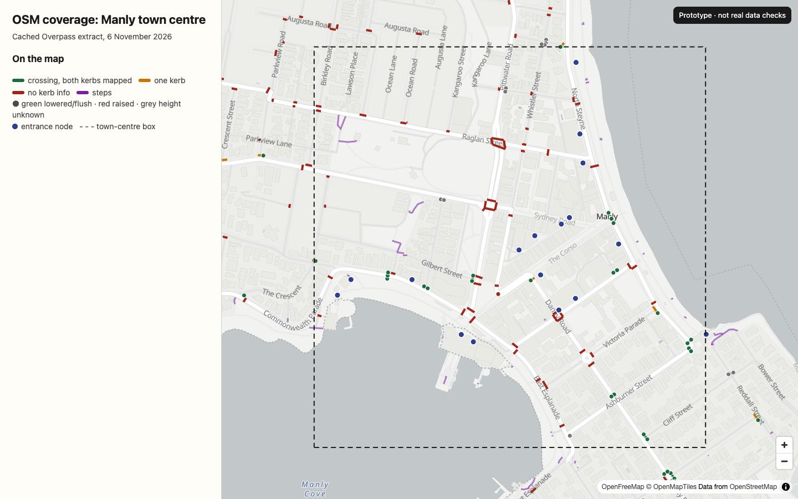
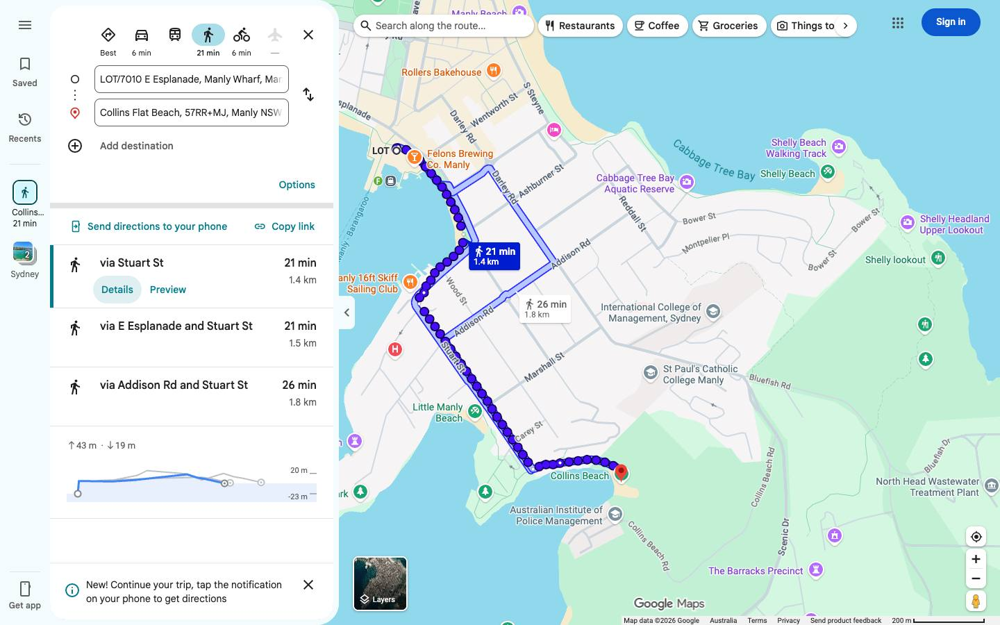
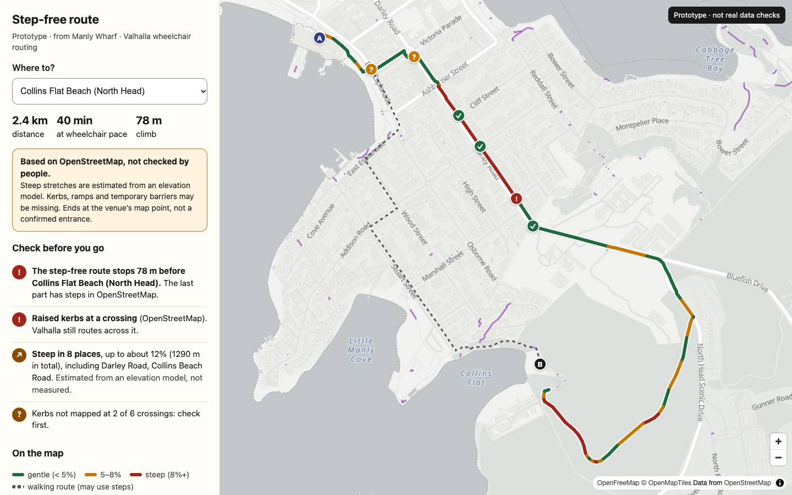
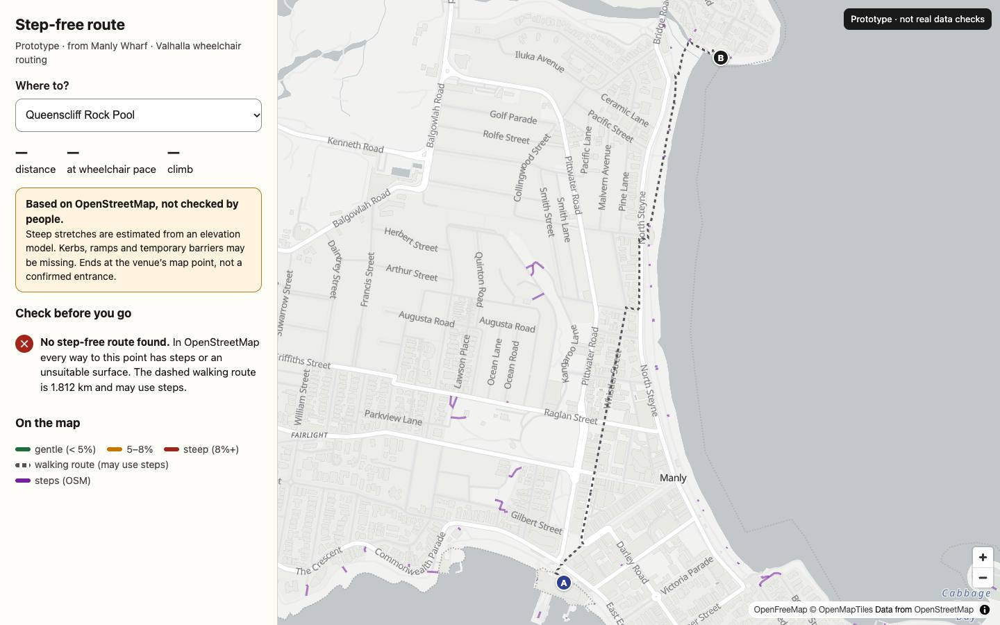
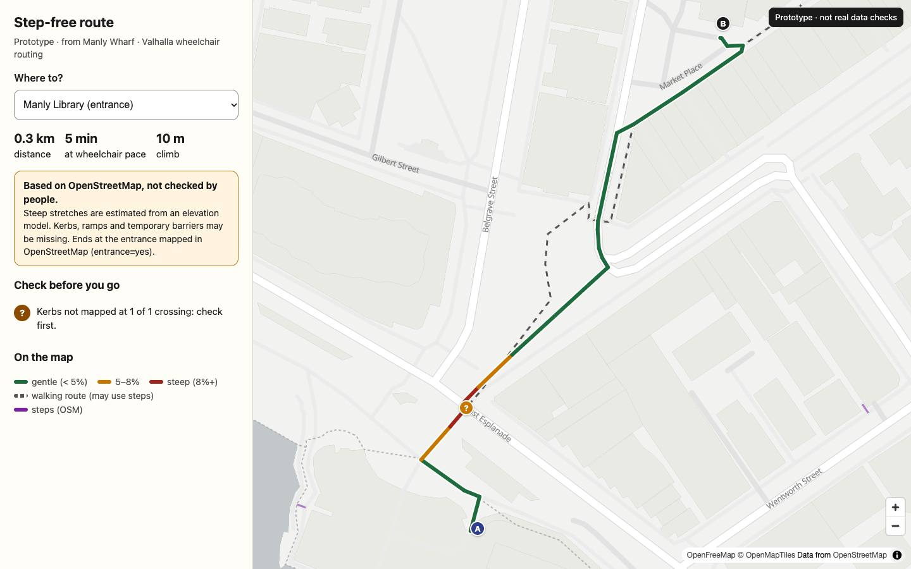
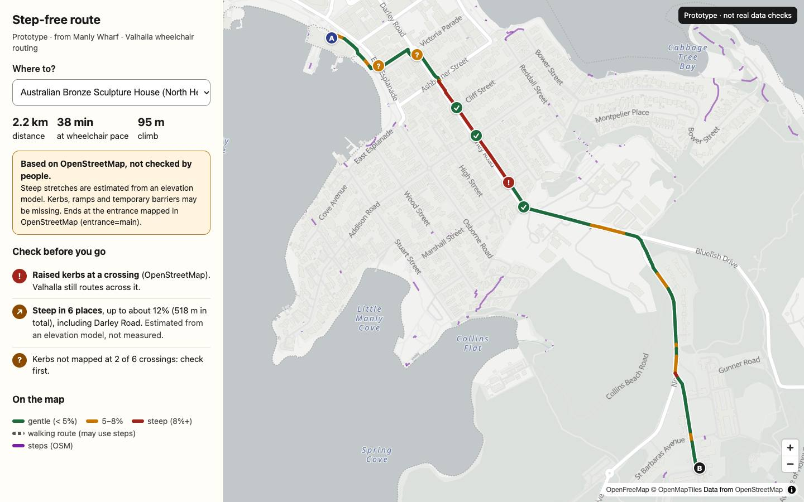
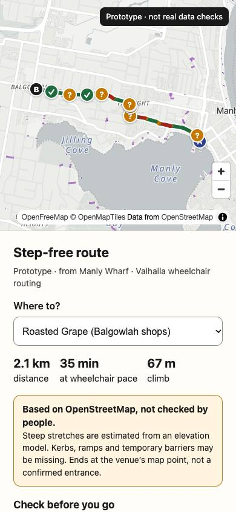

# Spike: step-free routing in Manly ("Getting there", stage 3)

**Question:** can Roam Access show a trustworthy step-free walking route from a person's
location to a venue's accessible entrance in Manly, and with what?

**Short answer: go with conditions.** Valhalla's wheelchair routing works in Manly and
reliably avoids *mapped* steps. But the route is only as good as OpenStreetMap, and in the
town centre OSM records kerbs at only **13%** of crossings, slope at **0.5%** of paths and an
entrance for **16%** of venues. Valhalla also routes across a crossing mapped with
**raised kerbs on both sides**. So we can show a route labelled as a draft, built on
OpenStreetMap, with "check first" points. We cannot call it a confirmed step-free route
until the town centre has been mapped (about one community mapping day) and we add our own
checks on top of the engine. Google's "Wheelchair accessible" walking option is not a usable
alternative (details below).

Date: 6 November 2026. OSM data as of `2026-11-06T07:23:48Z`. Research and a throwaway
prototype only: nothing here is in the app, and nothing touched production.

---

## 1. OSM data coverage

**Method.** One Overpass query (overpass-api.de answered this time when sent with a
descriptive User-Agent; the kumi.systems and private.coffee mirrors timed out). It fetched
every `highway=*` way, its nodes, and all kerb, crossing, entrance, barrier and tactile
paving nodes in the pilot bbox from `apps/app/scripts/seed-osm.ts`
(S −33.8150, W 151.2580, N −33.7800, E 151.3020; about 4.1 × 3.9 km). Venues come from the
seed query. The data is cached in [`step-free-routing/data/`](step-free-routing/data/) and
the numbers come from
[`scripts/coverage.py`](step-free-routing/scripts/coverage.py)
(`python3 -I docs/research/step-free-routing/scripts/coverage.py`).

**"Town centre"** is the box S −33.8020, W 151.2805, N −33.7935, E 151.2905 (about
1.0 × 0.95 km). It covers Manly Wharf, The Corso, the ocean beach front, Belgrave St, Sydney
Rd and the Darley Rd blocks. "Rest" is everything else in the pilot bbox: Fairlight,
Balgowlah, Queenscliff, Eastern Hill, North Head and Manly Vale. Each way is assigned to a
zone by its centroid. The pedestrian network is `footway`, `path`, `pedestrian`, `steps`,
`corridor`, `living_street` and `cycleway` (shared paths, unless `foot=no`).

| | Town centre | Rest of pilot area |
|---|---:|---:|
| Pedestrian network | 20.8 km | 141.0 km |
| …of which separately mapped sidewalks (`footway=sidewalk`) | 11.0 km | 77.2 km |
| Roads with any `sidewalk*=*` tag (by length) | 41% | 18% |
| **`surface`** on pedestrian ways (by length) | **69%** | **45%** |
| **`smoothness`** | **0%** | **3%** |
| **`incline`** (slope) | **0.5%** | **1.0%** |
| `width` | 11% | 8% |
| `wheelchair=*` on pedestrian ways | 1.2% | 1.0% |
| **`highway=steps`** | **26 flights, 362 m** | **159 flights, 3.4 km** |
| …with `ramp`/`ramp:wheelchair` · `handrail` · `step_count` | 9 · 12 · 5 | 34 · 73 · 29 |
| Crossings mapped as ways (`footway=crossing`) | 61 | 327 |
| Crossing nodes on roads (`highway=crossing`) | 94 | 500 |
| **Crossing ways with both kerbs mapped** | **15%** (13% with height known) | **9%** (6%) |
| …one kerb mapped | 3% | 6% |
| …no kerb mapped | 82% | 85% |
| Kerb nodes: lowered · flush · raised · height unknown | 21 · 5 · 1 · 5 | 59 · 1 · 3 · 19 |
| `tactile_paving` on crossing nodes | 62% | 26% |
| **`entrance=*` nodes** (with `wheelchair=*`) | **17 (1)** | **22 (4)** |
| **Venues (buildings) with an entrance node within 20 m** | **17 of 107 (16%)** | **1 of 60 (2%)** |
| Venues with a venue-level `wheelchair=*` | 26 of 107 | 4 of 60 |

*Red crossings have no kerb information. Purple lines are steps; blue dots are entrance nodes.
The dashed box is the town centre. Open it with `prototype/?coverage=1`.*

**What this means for routing**

- **The network is good.** Sidewalks are mostly mapped as separate ways, with 388 crossing
  ways and 185 flights of steps. That is enough for a router to avoid mapped steps and
  choose sides of the street.
- **Kerbs are the main gap.** At 82–85% of crossings OSM can't say whether there is a kerb
  ramp. For a wheelchair user that is the most common real barrier on an otherwise flat
  route.
- **Slope comes from an elevation model, not from OSM.** `incline` is almost never tagged.
  Valhalla uses a global elevation model (roughly 30 m resolution), which smooths over short
  steep ramps and driveways.
- **Entrances are mostly unmapped.** Without an entrance node a route ends at the venue's
  map point, usually the middle of the building or the street. Only one entrance in the town
  centre says whether it is wheelchair accessible.
- Steps are mapped well. Their attributes (ramp, handrail, step count) are mapped for about
  a third of them.
- **Not verified:** whether OSM is *complete* for steps, meaning no unmapped steps exist. A
  site visit is the only way to know. The Collins Beach Path steps are tagged
  `source=GPS`, so someone surveyed them.

---

## 2. Engines, 12 routes from Manly Wharf

The origin is the Manly Wharf forecourt (−33.79975, 151.2846). There are 12 destinations
from the venue extract: two flat controls, then places near steps and hills. Scripts:
[`valhalla-routes.mjs`](step-free-routing/scripts/valhalla-routes.mjs) (the results are cached
in `data/valhalla-routes.json`) and
[`google-maps-capture.js`](step-free-routing/scripts/google-maps-capture.js) (the results are in
`data/google-maps-walking.json`).

### 2a. Valhalla (FOSSGIS public server, `pedestrian` + `type: "wheelchair"`)

Each wheelchair route was also run with `type: "foot"` and then cross-checked edge by edge
against our OSM extract, using `trace_attributes` way ids. "Steep" means a Valhalla edge with
a maximum grade of 8% or more, from its elevation model. All 12 destinations needed 38
requests in total, sent 1.5 s apart.

| Destination | Wheelchair route | Climb | Steep edges (max) | Crossings: no kerb info / total | Ends | Foot route |
|---|---|---:|---|---|---|---|
| Manly Library | 0.32 km, 5 min | 10 m | 0 | 1 / 1 | 19 m from point (6 m from the OSM entrance) | same, no steps |
| New Brighton Hotel (Corso) | 0.44 km, 7 min | 10 m | 0 | 1 / 1 | 15 m | same |
| Manly Art Gallery & Museum | 0.36 km, 6 min | 12 m | 1 (10%) | 0 / 0 | 15 m (5 m from the OSM entrance) | **uses 1 step**; the wheelchair route avoids it |
| Fairy Bower Rock Pool | 1.25 km, 20 min | 34 m | 3 (9%) | 3 / 3 | 6 m | same |
| Shelly Beach (Boathouse) | 1.57 km, 25 min | 43 m | 3 (10%) | 3 / 3 | 7 m | same |
| Fairlight Beach Pool | 1.26 km, 20 min | 30 m | 3 (11%) | 2 / 2 | 16 m | same |
| Fairlight shops (Sydney Rd) | 1.12 km, 20 min | 56 m | 3 (11%) | 4 / 4 | 1 m | same |
| Little Manly (Ripples) | 1.06 km, 17 min | 27 m | 2 (10%) | 3 / 4 | 2 m | same |
| **Collins Flat Beach** | **2.39 km, 40 min** via Darley Rd and North Head | 78 m | 8 (12%) | 2 / 6, **one with raised kerbs on both sides** | **stops 78 m short**, still says "Your destination is on the left" | 1.55 km via Little Manly, **4 flights (49 steps)** |
| Bronze Sculpture House (North Head) | 2.17 km, 38 min | 95 m | 6 (12%) | 2 / 6, **same raised-kerb crossing** | 10 m (OSM entrance reached) | same |
| **Queenscliff Rock Pool** | **"No path could be found"** | | | | | 1.81 km |
| Balgowlah shops | 2.09 km, 35 min | 67 m | 4 (**14%**) | 7 / 9 | 2 m | same |

**Findings**

1. **Mapped steps were never used.** In all 11 wheelchair routes, zero `highway=steps`
   edges appear, including the two places where the foot route used steps (the gallery,
   and Collins Flat with 49 steps). Valhalla's source sets
   `kDefaultStepPenaltyWheelchair = 600` (10 minutes). Whether steps are banned outright or
   only heavily penalised is **not confirmed** from the source. In practice it detoured
   by up to 840 m instead of using steps.
2. **Raised kerbs are not avoided.** Collins Flat and the Bronze Sculpture House routes cross
   OSM way 1273244492 (an unmarked crossing on the way up Darley Rd towards North Head, at
   −33.8039, 151.2908). Both of its kerb nodes are tagged `barrier=kerb` and `kerb=raised`.
   Valhalla still routes a wheelchair across it and gives no warning.
3. **Steep slopes are not avoided either.** The wheelchair routes include edges Valhalla
   itself rates at 12–14%: a 316 m footway on the Balgowlah route and Collins Beach Road.
   Valhalla's default wheelchair `max_grade` is 12, so the grade limit is not enforced in
   practice. The source reportedly comments out the grade check because of "noisy data"
   (**not confirmed**). For comparison, AS 1428.1 allows 1:20 (5%) for a walkway and 1:14
   (7%) for a ramp (**from memory; check the standard**). Some of these routes are hills
   that many manual wheelchair users can't climb, and the wheelchair route was essentially
   the same as the walking route in 9 of 11 cases (within 15 m).
4. **It stops short without saying so.** For Collins Flat, Valhalla moved the destination to
   the nearest point it could reach, 78 m away on a bush track above the steps, and still
   said "Your destination is on the left". The app has to check the gap between the route's
   end and the destination itself.
5. **It says honestly when there is no route.** Queenscliff Rock Pool snaps to paths that are
   cut off from the network by steps and sand, so Valhalla returns no route rather than a
   wrong one. A route to the street above (Pavilion St / Queenscliff Rd) works: 1.6 km.
6. **Routing to an entrance works when the entrance is mapped.** With the destination set to
   the OSM entrance node, the Library route ends 6 m away, the Gallery 5 m and the Bronze
   Sculpture House 10 m.
7. **The output is usable.** It includes manoeuvres in en-AU, elevation every 10 m, and
   per-edge `surface`, `use` and grades through `trace_attributes`. The time uses 4 km/h.
8. **Temporary barriers can be avoided.** `exclude_polygons` works on the public server: a
   small box over The Corso changed the route (0.436 → 0.465 km, via Whistler St).
9. **Server policy.** I couldn't find a published usage policy, rate limit or update
   schedule for `valhalla1.openstreetmap.de`. It is a volunteer-run server, so treat it as
   suitable for research only.

### 2b. OpenRouteService `wheelchair`: **not tested (no key)**

The free API key needs a sign-up, which I didn't do. The parent thread asked Romy for a
key and the request timed out. From the documentation only (**not tested**):

- The wheelchair profile has restrictions that target exactly the gaps found above:
  `maximum_sloped_kerb` (0.03 / **0.06 default** / 0.1 m), `maximum_incline` (3 / **6
  default** / 10 / 15%), `minimum_width`, `smoothness_type` (default `good`),
  `surface_type`, and `avoid_features: ["steps"]`.
- The free tier allows 2,000 directions requests a day and 40 a minute. The key must stay
  server-side.
- OSM changes take "two to three weeks" to reach ORS. Australian coverage is not confirmed
  in its documentation.
- **To check when a key arrives:** with 82% of crossings missing kerb data, does
  `maximum_sloped_kerb` *exclude* unknown kerbs (no route) or *ignore* them (same as
  Valhalla)? Does it avoid the raised-kerb crossing? Does `maximum_incline: 6` find any
  route to Fairlight or Balgowlah? Run the same 12 destinations; the script structure can
  be reused.

### 2c. Google Maps walking with "Wheelchair accessible" ticked

Tested on google.com/maps in headless Chrome at 1440×900, en-AU, signed out. Walking
directions on the web now have **Route options → Wheelchair accessible**. The setting is
kept in the share URL (`data=…!2m1!10b1!3e2`), but it isn't one of the documented Maps URLs
parameters. The Routes API has no wheelchair option for `WALK`.

| | Result |
|---|---|
| Did the route change? | **In 2 of 12 cases.** For Fairlight Beach Pool and Queenscliff Rock Pool, the default walking route said "Take the stairs" and the wheelchair route avoided them (Queenscliff: +200 m, +3 min). The other 10 routes were identical. |
| Steps | **Collins Flat Beach:** the "Wheelchair accessible" route is the same as the walking route, down "Collins Flat Track" from Little Manly. OSM maps 4 flights there (5 + 4 + 18 + 22 steps, `source=GPS`). Google gives no warning. **Not verified:** whether Google's own data has these steps. They exist in OSM, and Valhalla's foot route used them. |
| Slope | No grade warnings. With the wheelchair option on, the panel shows climb totals (Collins Flat: ↑ 43 m ↓ 19 m). With it off, the same route says "All routes are mostly flat". Balgowlah shows ↑ 78 m with no warning. |
| Kerbs, surfaces | Nothing. |
| Where it ends | At a Google place, address or plus code, never an entrance. Our venue coordinates were reverse-geocoded to the nearest Google place: "The 152 Project" for Manly Library, "Manly Stepping Rocks" for Fairy Bower Rock Pool, "1 Marine Parade" for Shelly Beach. |
| Warnings | Only the generic "Use caution – walking directions may not always reflect real-world conditions". |
| Time | Walking pace with or without the option (Collins Flat 21 min; Valhalla wheelchair 40 min). |
| Using it in our app | We can't draw Google routes on our MapLibre map. As I understand the Google Maps Platform terms, Google content must be shown on a Google map (**check the terms**). At most we can offer an "Open in Google Maps" link. |

### Comparison

| | Valhalla wheelchair | ORS wheelchair | Google "Wheelchair accessible" |
|---|---|---|---|
| Avoids mapped steps | Yes, in all 11 routes | Documented (`avoid_features`); not tested | Only sometimes (2 of 3 step cases) |
| Avoids raised kerbs | **No** | Documented (`maximum_sloped_kerb`); not tested | No information |
| Avoids steep slopes | **No** (uses 12–14%) | Documented (`maximum_incline`); not tested | No |
| Ends at an entrance | If we pass the entrance coordinate | If we pass the entrance coordinate | No (place, address or plus code) |
| Says when it can't reach the place | Yes ("no path"), **except** a silent 78 m short stop | Not tested | No |
| Warnings | None (we compute them) | Extra info (steepness, surface, kerbs) per the docs; not tested | Generic only |
| Can draw it on our map | Yes (MIT licence, OSM data under ODbL) | Yes (OSM data under ODbL) | No (link out only) |
| Can feed in our community reports | Yes (`exclude_polygons` / `exclude_locations`) | `avoid_polygons` per the docs; not tested | No |

---

## 3. Prototype

A throwaway static page:
[`step-free-routing/prototype/index.html`](step-free-routing/prototype/index.html). It uses
MapLibre with the app's basemap (OpenFreeMap Positron) and draws the cached Valhalla
wheelchair routes. The line is coloured by slope (green under 5%, amber 5–8%, red 8% and
over, computed over 30 m windows from Valhalla's 10 m elevation samples). Crossing markers
show ✓ for lowered or flush kerbs, ? for kerbs not mapped and ! for raised kerbs. The dashed
grey line is the walking route; mapped steps are purple. The side panel shows the summary,
an honesty label and a "Check before you go" list. For the Library, the Gallery and the
Bronze Sculpture House, it routes to the OSM entrance node.

To run it: `cd docs/research/step-free-routing && python3 -m http.server 3101`, then open
`http://127.0.0.1:3101/prototype/?dest=collins`, or `?coverage=1` for the coverage map. It
makes no live routing calls; everything comes from `data/`.

| | |
|---|---|
|  |  |
|  |  |

The prototype is not production-ready: it has no keyboard route list, its map markers are
`aria-hidden` (the same warnings are in the text list), and it was not checked against the
design system. That is fine for screenshots, but a real feature needs the `ds/` components
and a text-first route description.

---

## 4. Recommendation: **go with conditions**

**Engine: self-hosted Valhalla, plus our own checking layer.**

- **Why Valhalla:** it is open source (MIT), avoided mapped steps every time, can route to
  entrance coordinates, gives elevation and per-edge attributes, supports exclusion
  polygons, and runs on data we can fix ourselves.
- **Not the public FOSSGIS server in production.** It has no published policy and is run by
  volunteers. Use it for development only.
- **Self-host** the Docker image (`ghcr.io/valhalla/valhalla`, or the community
  `docker-valhalla` scripts) with a Greater Sydney extract clipped from Geofabrik's
  Australia file using osmium, plus elevation tiles. Rebuild it nightly or weekly.
  - **Size estimate (not measured):** 1–2 vCPU and 2–4 GB RAM is enough for a city extract.
    That is roughly A$20–60 a month on a Sydney-region VM or container host (AWS
    ap-southeast-2, DigitalOcean SYD1, Vultr Sydney).
  - It can't run inside a Vercel Function (native binary plus tiles on disk). The Next.js
    API route would call it server-side.
- **Our own checking layer, a few hundred lines of TypeScript.** After each route, cross-check
  every edge against our OSM copy and:
  - mark raised or unknown kerbs, and steep stretches over 5% and 8%;
  - flag a gap over 25 m between the route's end and the entrance;
  - return "no step-free route found" honestly.
  - **Raised kerbs:** before building the tiles, pre-process the extract so that a crossing
    with a `kerb=raised` node becomes `wheelchair=no`. Valhalla honours `wheelchair=no` on
    ways through its access mask (**to confirm in testing**). Steep-grade avoidance would
    need either a patched Valhalla or the same pre-processing using `incline`.
- **Re-test ORS** once a key exists. If it really enforces kerb and incline limits, it might
  do better than Valhalla here, but only where those tags exist, and they mostly don't.

**Data first: a town-centre mapping day before launch.** Rough estimate, not measured:

| Task (town centre) | Items | Rate (on foot with StreetComplete or Every Door) | Hours |
|---|---:|---:|---:|
| Kerb type at both ends of each crossing (including splitting node-only crossings into ways) | about 155 crossings, about 300 kerbs | 40–60 kerbs/h | 5–8 |
| Venue entrances: position, `wheelchair`, step count or ramp, door width | 107 venues | 12–20/h | 5–9 |
| `incline` on the main corridors (Corso, Belgrave, Sydney Rd, the Esplanades, Darley Rd), checked with a phone level | about 8 km | about 2 km/h | 4 |
| `surface` / `smoothness` / `width` on the remaining paths | about 6.5 km | done alongside the above | 2 |
| Editing, review, upload | | | +25% |
| **Total** | | | **about 20–29 person-hours: one Saturday for 5–6 people** |

Surveying the rest of the pilot area is about 5–6 times as much work (141 km of network,
327 crossings) and much hillier. **Launch routing in the town centre only.** Elsewhere, show
the route with a stronger "check first" label, or only as far as the town-centre edge.

**How to label routes honestly** (all copy through `t()`, en-AU):

- The title is "Route avoiding mapped steps", **never** "Accessible route" or "Step-free
  route" on its own.
- Show the source line every time: "Based on OpenStreetMap, not checked by people. Slopes
  are estimated."
- **Check before you go:** "Kerbs not mapped at 3 crossings: Marine Parade, …",
  "Raised kerb at North Head Scenic Dr", "Steep: about 12% for 90 m on Darley Rd".
- **Where it ends:** "Ends at the entrance mapped in OpenStreetMap" or "Ends at the street:
  the entrance isn't mapped yet".
- **When it falls short:** "No step-free route found to the pool. The nearest point without
  steps is Pavilion St, 120 m away." (illustrative distance)
- **Time** at wheelchair pace, plus total climb ("78 m climb").
- **Never colour alone.** The prototype already pairs icons with words. Screen-reader users
  need the route as a text list of segments and warnings, not just the map.
- **Routing never changes a verdict**, and OSM-derived route facts are "unconfirmed", as
  `AGENTS.md` requires for all OSM data.

**How community reports feed in**

- **Temporary barriers** (`temp_barriers`): reports on a facility already have a location
  (`facilities.lat/lng`). Pass active, unexpired, unresolved reports to the route request as
  `exclude_polygons` (about a 10 m circle), and say so: "Avoiding: lift out of order at …
  (reported 2 days ago)". Today `target_type` is only `venue | facility`. Reporting a
  barrier *on the way* (works, a blocked kerb ramp) needs a new target type with lat/lng,
  which is an additive migration.
- **Route feedback:** after a route, ask one quick question ("Was this route OK?
  Yes / There was a barrier at…"). Reports become "check first" points on later routes, and
  a moderator or mapping-day volunteer turns confirmed ones into OSM edits. **We never write
  to OSM automatically** (OSM's organised-editing guidelines apply).
- **Reviews of entrances** ("step-free entrance on Belgrave St side") can set *our*
  entrance coordinate for a venue. That is community data, so it can be shown as confirmed,
  unlike OSM.

**Next steps if Romy says go**

1. Test ORS with a key (½ day).
2. A Valhalla Docker build with a Sydney extract and the raised-kerb pre-processing; check
   that `wheelchair=no` is honoured (1–2 days).
3. A server-side `/api/route` with the checking layer and `temp_barriers` exclusions (2–3
   days).
4. A "Getting there" UI with the `ds/` components and a text-first route (3–5 days).
5. A town-centre mapping day (one Saturday, 5–6 people).

---

## Not verified / limits

- Whether Valhalla bans steps outright or penalises them, and that the grade check is
  disabled. Both are inferred from behaviour plus a partly readable source file.
- Whether Google's data has the Collins Flat steps; Google's licence terms (from memory).
- ORS behaviour: **not tested (no key)**.
- How accurate the elevation model is on short ramps and driveways. No ground truth was
  measured.
- The mapping-hours estimate is an assumption, not a measurement.
- The hosting cost is an estimate; no instance was built.
- AS 1428.1 gradients are quoted from memory.
- How complete OSM steps and kerbs are on the ground: no site survey was done.
- The Valhalla origin snapped to the wharf walkway. All Google routes started from
  "LOT/7010 E Esplanade" (the same forecourt).

Data © OpenStreetMap contributors (ODbL). Routes by Valhalla on the FOSSGIS server.
Basemap © OpenFreeMap / OpenMapTiles.
