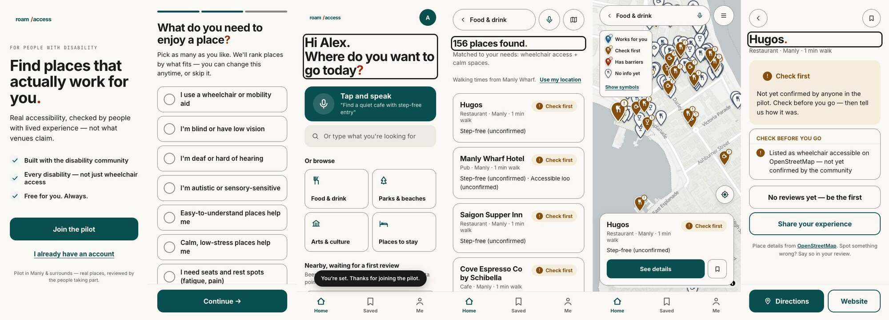
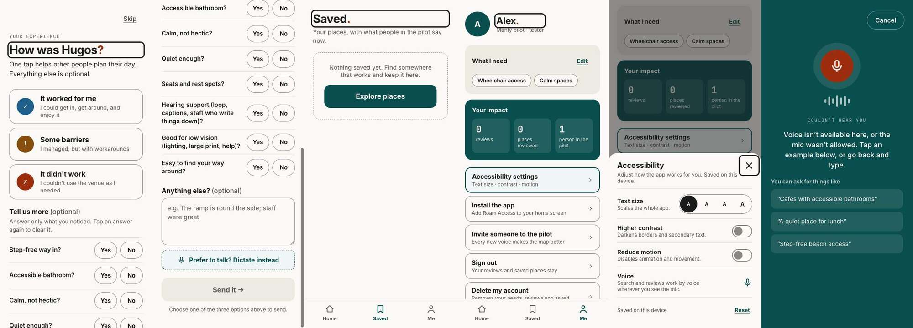
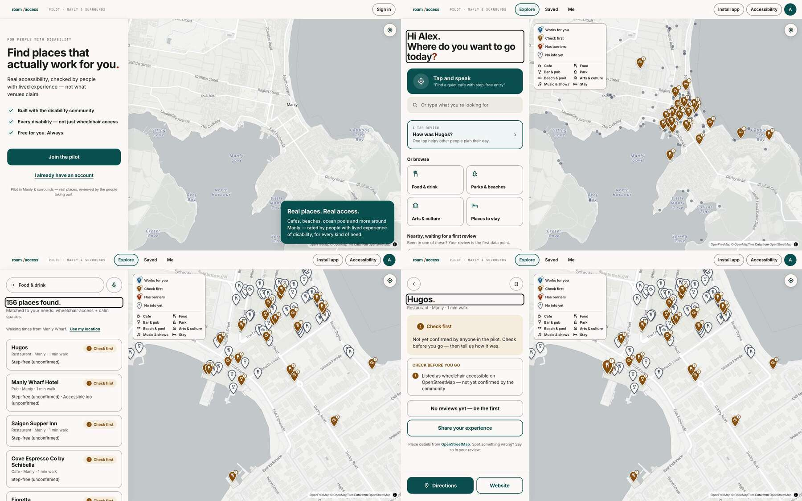

# Roam Access pilot: UX review and design direction

*6 November 2026. Every screen of the pilot (`apps/app`, the same code as
https://roam-access.vercel.app) was captured at 390×844 and 1440×900 with a Clerk test user
(needs: wheelchair access + calm spaces). Screenshots: [`docs/ux-review/`](ux-review/).*

## What already works (keep it)

- **One clear verdict**, written as icon + colour + words, personalised to *your* needs. No
  competitor does this; Wheel the World's "Match" comes closest, and only for hotels.
- **Honesty is visible.** OpenStreetMap hints read "Step-free (unconfirmed)"; nothing turns
  into "Works for you" without reviews.
- **The accessibility basics are solid.** 48 px targets, a skip link, focus moves to the
  screen heading, a dialog focus trap, route announcements, in-app text size, contrast and
  motion settings, and self-hosted fonts.
- **Voice first, plus a one-tap review.** This is the lowest-effort review flow in the
  category.

## Gaps, most important first

| # | Gap (seen in the screenshots) | Why it hurts people with disability |
|---|---|---|
| 1 | **The results list doesn't help you decide.** "156 places found." are nearly all "Check first", with no filters (category, verdict, needs), no sort and no summary of how many places work for you. | Scanning 156 near-identical cards is slow with a screen reader, switch access or fatigue. |
| 2 | **On mobile, map and list are separate screens.** The map shows one card at a time, and the legend permanently covers part of the map. | Two modes to learn; with the legend open, pins are hidden behind it. |
| 3 | **Search isn't persistent.** On Home, the text field is behind a "type instead" button; on Results, the query is a back button. | Refining a search means going back and starting again, which costs more steps and more working memory. |
| 4 | **The venue page has no summary block.** Actions are split (Save at the top; Directions and Website at the bottom), there is no Share, Call and Website exclude each other, and there's no "last updated" or source per fact. | Before a trip, people need to know how much to trust a fact and when it was checked. Stale data is the top complaint about AccessNow, and AbleVu labels the source of every fact. |
| 5 | **Loading is shown as text.** "LOADING PLACES…" in monospace, with layout shifts when content arrives. | The page jumps. A skeleton keeps the layout stable and still announces "Loading" once. |
| 6 | **Empty and error states are inconsistent.** Saved uses a dashed box, other screens show only a toast, and Me shows "0 · 0 · 1" stats. | Dead ends without a next step are worse for people with cognitive disability or low stamina. |
| 7 | **The visual hierarchy is flat.** Everything is a 1.5 px outlined card with 16–18 px radii; sizes range from 13.5 to 17.5 px with no scale; spacing is set by hand everywhere. | A weak hierarchy makes low-vision users read everything; at 150% text the even weight gets worse. |
| 8 | **Desktop: the panel and the map aren't linked.** Hovering a list row doesn't highlight its pin, and the selected venue isn't marked in the list. The legend also covers the map. | People with low vision and people who use magnifiers lose their place between list and map. |
| 9 | **The review form shows nine yes/no questions at once**, not ordered by your needs. | It looks long, so people abandon it even though it's optional. |
| 10 | **The install prompt is in the header and in Me**, with no reason given. | It's noise until someone has a reason to install, such as after saving a place. |

## How the leading apps handle it, and what we adopt

| Pattern | Seen in | We adopt it as | Why it helps |
|---|---|---|---|
| Persistent search bar with a row of **filter chips** under it ("Open now", "Wheelchair accessible", ...) | Google Maps, Airbnb, AbleVu (8 need categories) | `ChipGroup` + `FilterChip`: categories, **"Works for me"**, verdict, needs | One tap instead of typing; chips are real toggle buttons (`aria-pressed`) with a ✓ icon, so selection never depends on colour. |
| **Bottom sheet over the map** with peek / half / full heights, and a list/map toggle | Google Maps, Apple Maps | `SnapSheet` (draggable, **and** a handle button that works with Arrow keys, Enter or a switch) + `SegmentedControl` (List / Map) | Map and list on one screen. The list stays the primary, screen-reader-friendly view. |
| **Action row** under the place name: Directions · Call · Website · Save · Share | Google Maps, Apple Maps | `ActionRow` | Large targets with icon and label, always in the same order and place; Share fits how people plan trips with a carer. |
| **Summary first, then sections** (amenities grouped, "Show all") | Airbnb, Google Maps "About" | `Card` + `SectionHeader` + `ListRow` | Verdict, key facts and freshness are visible without scrolling; screen-reader users can jump between headings. |
| **Where each fact came from** ("Venue says", "Community", "Partner") | AbleVu (six labelled sources), Accessible Australia ("self-reported") | `SourceBadge`: Community · N reviews / Venue says / OpenStreetMap · unconfirmed | Lets people judge trust, and enforces our honesty rule visually. |
| **"Last updated" / "still accurate?"** | AccessNow complaints; AccessAble's 18-month expiry | `Badge` + date format `6 November 2026` | Old information is the biggest reason people stop trusting these apps. |
| **Photo-first cards and reviews** | Airbnb (a photo for each accessibility feature), Sociability, Wheel the World | `Card` media slot (used by the photos feature) | People can judge a step or a door for themselves. |
| **Skeleton loading** | Airbnb, Google Maps | `Skeleton`, `SkeletonList` (one live "Loading" message; the shimmer stops when motion is reduced) | Stable layout; nothing moves for people who are sensitive to motion. |
| **Helpful empty states** with one next step | Airbnb ("No exact matches · Remove filters") | `EmptyState`, `Banner` (offline, errors, outside the pilot area) | Never a dead end; for the "no results" state, the action removes the last filter. |
| **Simple one-tap rating first, then optional detail** | AccessNow Quick Rate, Sociability Sweet/Sour, Euan's Guide | Keep our 3-way verdict; order the detail questions by **your needs first**, with the rest under "More questions" | Shorter forms mean more reviews and less fatigue. |
| **Selection synced across list and map** | Airbnb, Google Maps desktop | `ListRow selected` and highlighting the pin on hover/focus | Keeps your place for people with low vision and people who use magnifiers. |

**Where we deliberately differ from these apps:** no tiny text links, no swipe-only gestures,
no hover-only information, no colour-only states, no auto-advancing carousels and no
infinite scroll. Every sheet has a button alternative to dragging, and every filter is
announced.

## The design system (`apps/app/components/pilot/ds/`)

It's built on the live `C2` palette, so the **Higher contrast** setting keeps working:
shadows become 2 px borders, and secondary text and lines darken.

- **Tokens:** a type scale (`display 34 → caption 13`; nothing under 13 px, and 16 px for
  inputs), 4-based spacing, radii (`sm 10 · md 14 · lg 18 · xl 24 · pill`), elevation
  levels 0–3, motion durations (`fast 120 · base 200 · slow 300 ms`, all 0 when motion is
  reduced), target sizes (`min 44 · std 48 · lg 56`), and tone colours (all ≥ 5.2:1;
  borders ≥ 3:1).
- **Components:** Button, IconButton, Card, Chip / FilterChip / ChipGroup, Badge /
  SourceBadge, ListRow / List, SectionHeader, Skeleton, EmptyState, Banner, ActionRow,
  Tabs / SegmentedControl, Sheet (modal) and SnapSheet (persistent), and Icon.
- **Preview:** `/ds` shows every component in every state, with switches for high contrast,
  reduced motion and text size, plus a live contrast table. It's open in local and Preview
  builds and admin-only in production, and it's `noindex`.

## Phase B plan (applying the design system once the feature PRs merge)

1. **Mobile Explore:** a persistent search bar and filter chips; the map with a `SnapSheet`
   list; a List/Map `SegmentedControl`; and a summary line ("12 work for you · 40 check
   first").
2. **Desktop:** a wider list panel; pins highlight on row hover or focus; the selected row
   is marked; the legend collapses.
3. **Venue:** a summary block (verdict, top 3 facts with sources, last updated), then
   `ActionRow`, then sections (Barriers, What works, Check before you go, Reviews, Photos,
   Details).
4. **Skeletons** for bootstrap, reviews and the venue page; `EmptyState` for Saved, no
   results and offline.
5. **Onboarding:** explain what verdicts mean before the first search; consistent headers
   and back buttons; install prompt shown after the first save, on the Me screen.
6. **Contrast check** for every new colour pair; check every screen at 200% text, with high
   contrast, with reduced motion, and keyboard-only.
