# Map: show every place in view, smaller markers as you zoom out

Romy after PR #37: "I don't like that the pins disappear, it looks odd. Make the pins
smaller and show everything in the area you're looking at." Still **no clustering** and
**no big stacked pins**.

## What changed

- **Every place in view is on the map.** The map draws every place of the current search
  and filters (with no search: every place), from anywhere, not just the list page. Nothing
  is hidden by collisions any more; overlapping is fine.
- **Marker size follows zoom**, the way Google Maps shows points of interest:

  | Zoom | Places with a verdict | "No info yet" |
  |---|---|---|
  | < 14 (suburbs, city) | ~8px of colour in the verdict **shape** (circle works · diamond check first · octagon barriers) with a white ring, no icon; a little smaller still across a whole city (≤ 11) | 5px grey dots |
  | 14–15 | 22px verdict shapes with the category icon, no badge | 7px grey dots |
  | ≥ 16 (street) | category pins with the ✓ ! ✗ badge, 15 % smaller than before; places in one building nudged apart (as in #37) | small pale markers with the category icon |

  The selected, hovered (list row) and keyboard-focused place is always the full pin.
  Draw order, bottom to top: no info yet, has barriers, check first, works for you.
  Even the smallest dot says its verdict by shape as well as colour. The octagon dot has
  shorter cut corners than the big one so it doesn't read as a circle at 8px.
- **Fast at Sydney scale.** All markers are drawn by WebGL: one GeoJSON source plus
  circle and symbol layers (`components/pilot/map/placeLayers.js`). The sprites are
  drawn on a canvas from the same SVG paths as the DOM pins and the Key
  (`map/symbols.js`). Only the list page's places and the selected place are DOM buttons.
- **Clicking and the keyboard.** A click or tap goes to the nearest marker within 12px
  (a 24px box), whether it's a WebGL dot or a list pin. It opens the existing card: next
  to the pin on desktop, under the map on phones. Only the list page's places are in the
  Tab order, in list order. Pins outside the view are hidden, so Tab never reaches one
  you can't see. Screen readers hear "N places in this area; use the list to browse
  them."
- **"Search this area"** stays and only narrows the **list**, because the map already
  shows everything.
- **Key and layers.** The Key (phones) and the legend (desktop) show the three looks of
  each verdict: dot, shape and pin. The text explains dot = place, colour + shape =
  verdict, grey = no info yet. "Show places with no info yet" is **on by default**.
  Toilets, beach and parking follow the same tiers as squares (small square → square
  with icon → square pin), drawn on top.
- Replaces the collision tiers proposed in the desktop-search draft (PR #38 §6).

## Checks (production build, headless Chrome)

- **Speed with `?mapStress=1`** (3,232 places + 400 toilets, toilets layer on), 60 drag
  steps at desktop 1440×900:

  | Zoom | Markers drawn (WebGL) | DOM pins | Median frame | p95 | Worst |
  |---|---|---|---|---|---|
  | 11 (city) | 2,399 | 10 | 16.7 ms | 16.7 ms | 33.3 ms |
  | 13 | 619 | 10 | 16.7 ms | 16.7 ms | 16.8 ms |
  | 16.3 (street) | 20 | 10 | 16.7 ms | 16.8 ms | 16.8 ms |

- **Clicks:** 12 of 12 exact clicks on WebGL marks and dots (Manly, zoom 15) selected
  that place, and so did a click on a list pin. A click 11px away from a dot still
  selected it, and Escape put focus back on its pin.
- **Keyboard** (desktop, zoom 15): Tab went through exactly the 10 list pins, in list
  order. Each became a 44×55 full pin with a visible focus ring.
- **axe-core (WCAG 2.2 AA):** 0 violations on the phone map, the phone Key (also at
  200 % text) and the desktop map at street zoom. At zoom 13–15 on desktop, axe
  reports `target-size` where two list pins sit a few metres apart (e.g. Hugos and Manly
  Wharf Hotel on the wharf). Overlap is Romy's decision (no hiding, no clustering, no
  spreading at city zoom). WCAG 2.5.8's "equivalent" exception covers it: each of those
  places is a ≥ 56px row in the list beside the map. Clicks go to the nearest marker, and
  from zoom 16 the pins are nudged apart (0 violations there).

## Screenshots

`before-*` = `main` (#37). `after-*` = this branch. Manly at zoom 13, 15 and 16.5, and
the Sydney stress test (the after-shots are centred slightly further east, on the CBD).
Desktop 1440×900, phone 390×844.

| | Before | After |
|---|---|---|
| Desktop, Manly, zoom 13 | 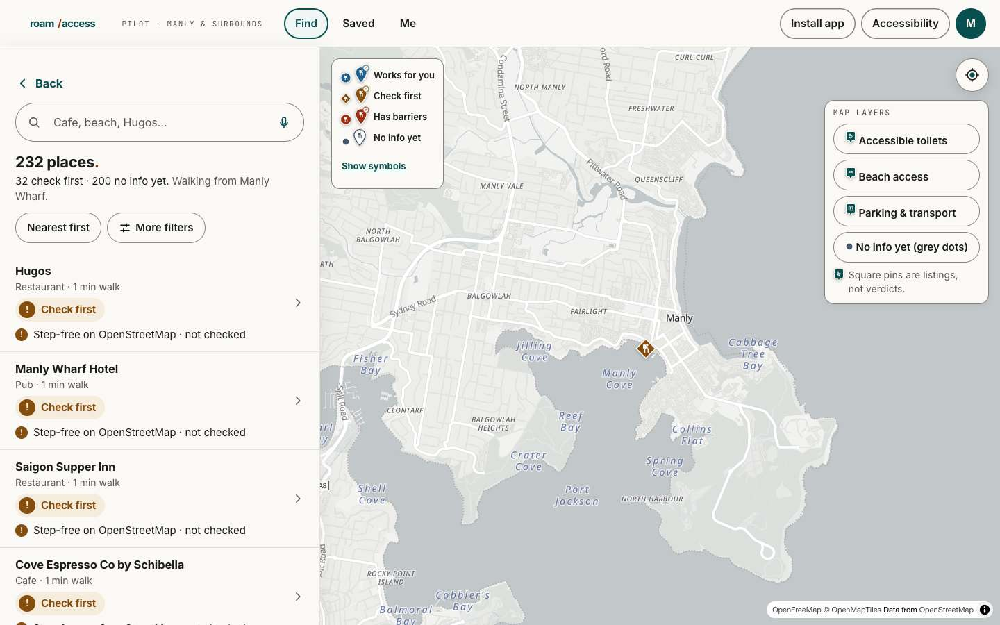 | 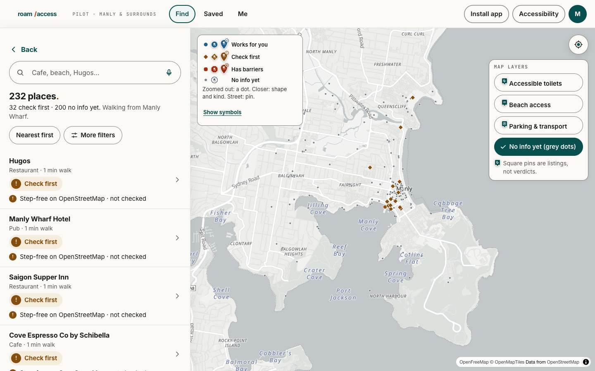 |
| Desktop, Manly, zoom 15 | 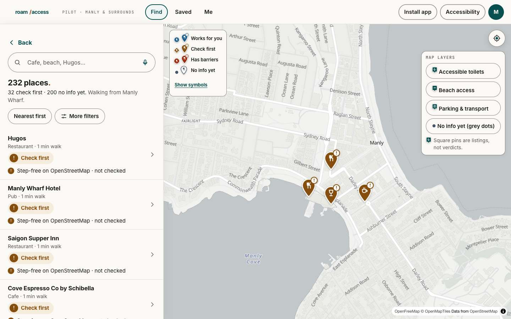 | 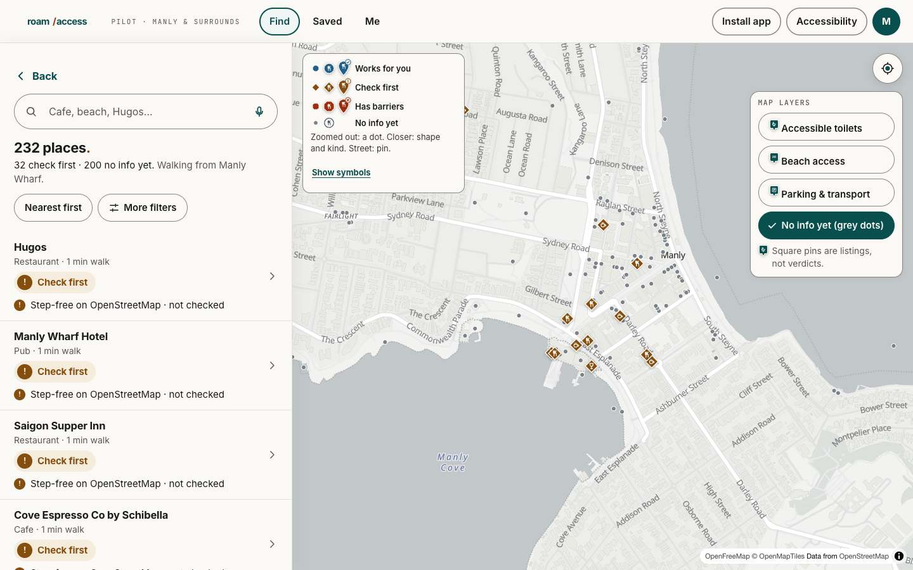 |
| Desktop, Manly, zoom 16.5 | 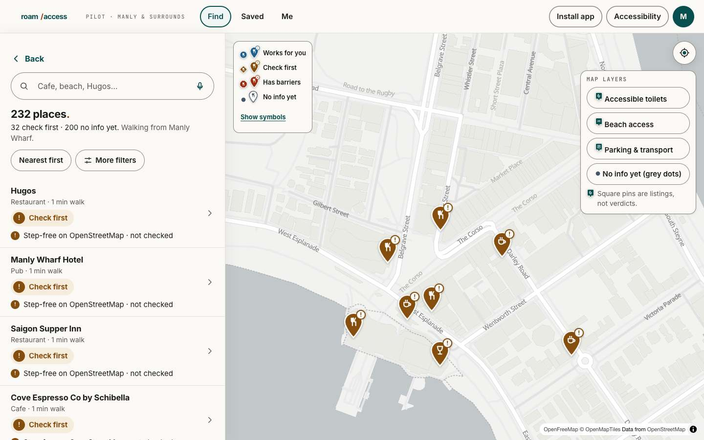 | 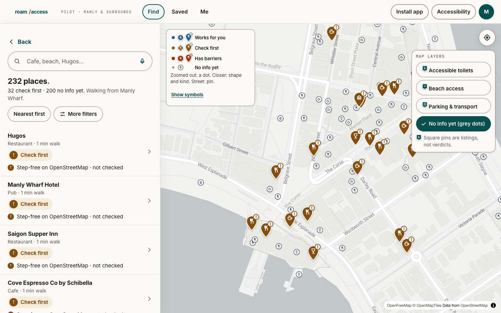 |
| Desktop, Sydney stress, zoom 11 | 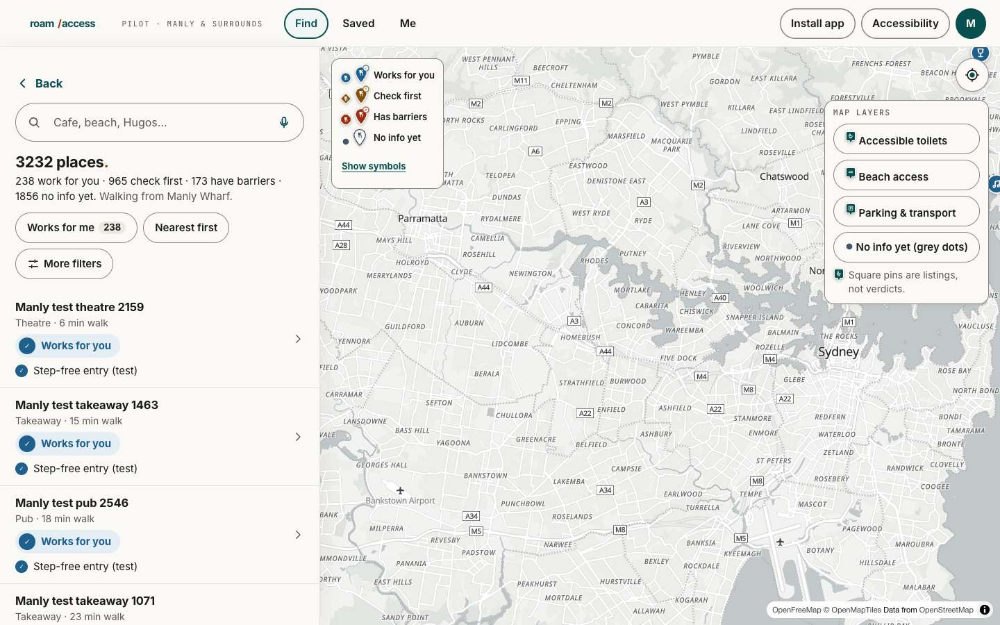 | 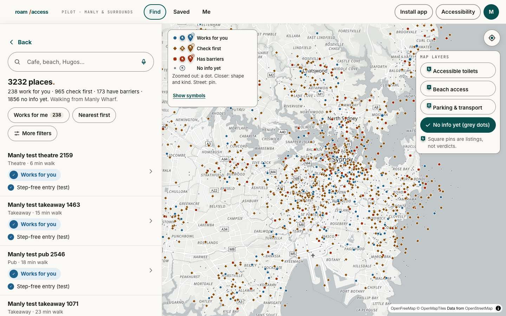 |
| Desktop, Sydney stress, zoom 13 | 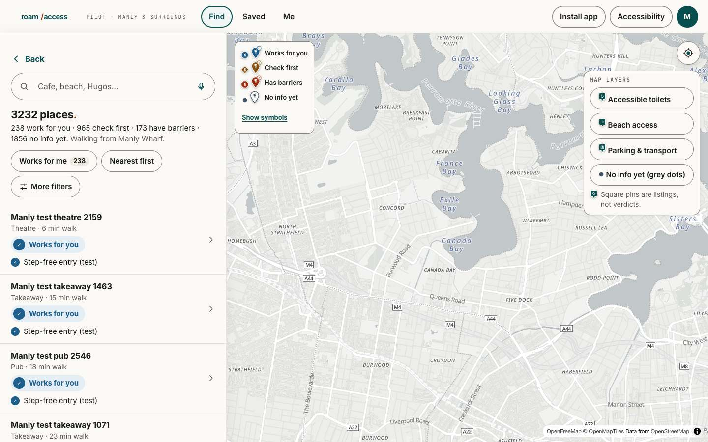 | 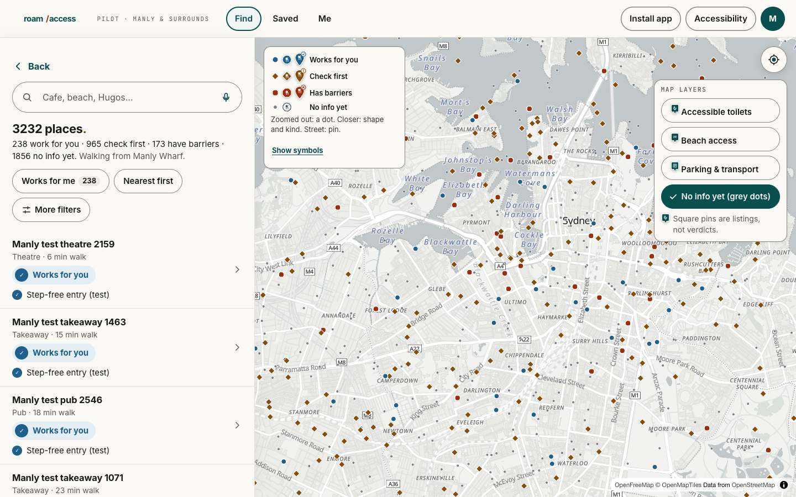 |
| Phone, Manly, zoom 13 | 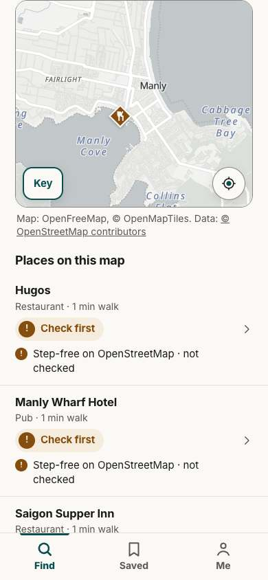 | 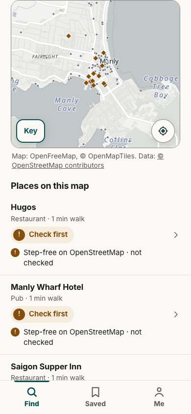 |
| Phone, Manly, zoom 15 | 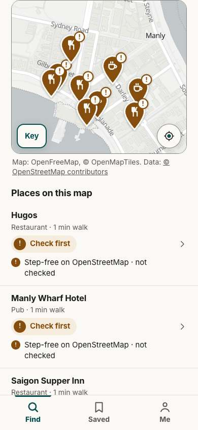 | 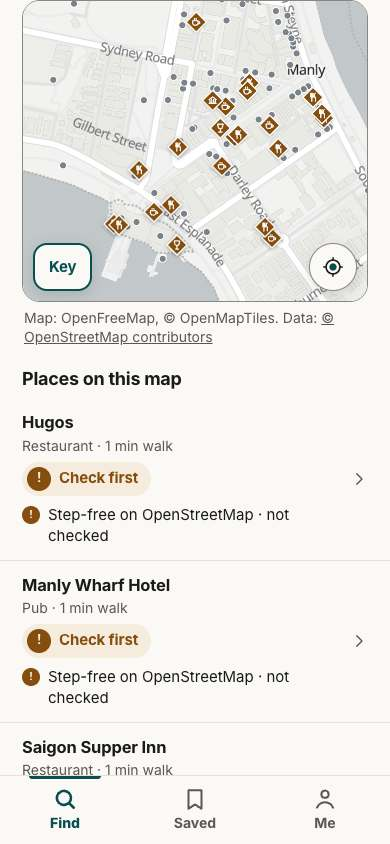 |
| Phone, Manly, zoom 16.5 | 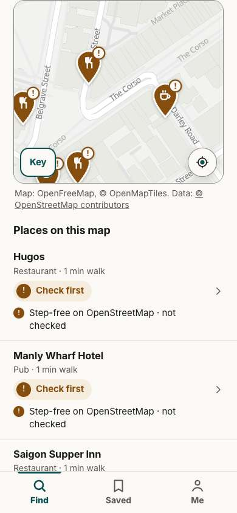 | 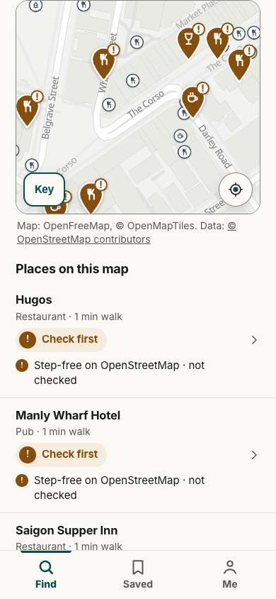 |
| Phone, Sydney stress, zoom 11 | 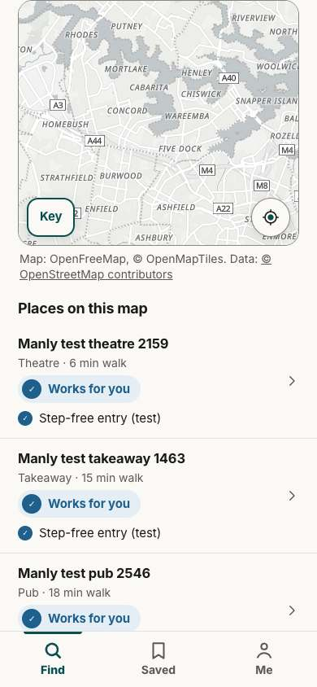 | 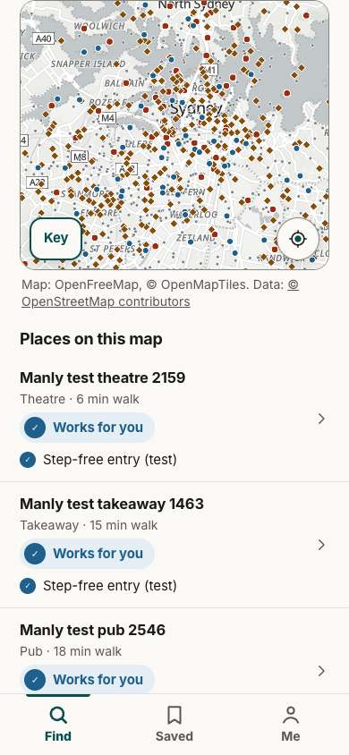 |

More after-shots: `after-desktop-stress-z16.3.jpg` (street pins in the CBD),
`after-desktop-stress-toilets-z13.5.jpg` (toilet squares), `after-desktop-click-grey-dot.jpg`
(a dot → its card), `after-desktop-keyboard-focus.jpg` (third Tab stop = third row, as a
full pin), `after-phone-tap-dot.jpg`, `after-phone-key.jpg`.
